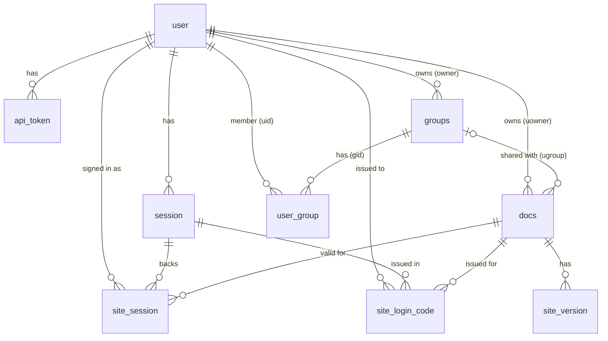

# Database schema

open-pages keeps its state in one SQLite file, `data.db`, in the data directory
(`[paths] datapath`). The driver is the pure-Go `modernc.org/sqlite`. The schema is defined
in `internal/store/store.go`: a `CREATE TABLE IF NOT EXISTS` script plus idempotent migration steps, both run
on every start. Site files are not in the database; see
[getting-started.md](getting-started.md#data-directory-layout).

The database is opened with `foreign_keys` on and a 5 second `busy_timeout`. Journal mode is
SQLite's default (rollback journal); the code does not enable WAL.

## Relationships



`audit_log` has no relationships on purpose; see its section.

As plain text:

```text
user 1---* session        (session.userid)
user 1---* site_session   (site_session.userid)
user 1---* site_login_code (site_login_code.userid)
session 1---* site_session     (site_session.sessionid, ON DELETE CASCADE)
session 1---* site_login_code  (site_login_code.sessionid, ON DELETE CASCADE)
docs 1---* site_session        (site_session.siteid, ON DELETE CASCADE)
docs 1---* site_login_code     (site_login_code.siteid, ON DELETE CASCADE)
docs 1---* site_version        (site_version.docid, ON DELETE CASCADE)
user 1---* api_token      (api_token.userid)
user 1---* groups         (groups.owner, nullable)
user 1---* docs           (docs.uowner, nullable)
user 1---* user_group *---1 groups    (user_group.uid, user_group.gid)
groups 1---* docs         (docs.ugroup, nullable)
```

"docs" is the table of sites: one row per site. `user_group` is the many-to-many link
between users and groups. Apart from the five cascading keys above (`site_session` and `site_login_code`, to
`session` and to `docs`, and `site_version` to `docs`), no foreign key has an `ON DELETE` action, so SQLite refuses to
delete a referenced row (the default `NO ACTION`); the application deletes memberships
before groups and never deletes users.

## Tables

Declared types are SQLite type names; SQLite does not enforce the lengths in `VARCHAR(n)` or
`CHAR(n)`, so limits such as 64 or 512 are enforced by the API (in bytes or characters as
noted). Unix timestamps are integer seconds since the epoch, UTC.

### user

One row per account: local, or created by OIDC or SAML sign-in.

| Column | Type | Constraints | Notes |
|---|---|---|---|
| `userid` | INTEGER | PRIMARY KEY | Rowid alias, auto-assigned |
| `email` | VARCHAR(255) | NOT NULL | Account name. Unique (index `user_email`) |
| `password` | BINARY(60) | NOT NULL | bcrypt hash (60 characters). Empty string `''` for OIDC and SAML accounts, which never matches a password |
| `oidc_issuer` | TEXT | NULL | Issuer of the identity provider: the issuer URL for OIDC, the IdP's entity ID for SAML; NULL for local accounts |
| `oidc_subject` | TEXT | NULL | `sub` claim at that issuer for OIDC; the persistent NameID (or the `nameid_attribute` value) for SAML; NULL for local accounts |

The `oidc_` prefix predates SAML support. Both sign-in methods share these columns (and
`user_group.oidc`) rather than having their own; renaming them is deliberately not done.

Indexes:

- `user_email`: UNIQUE on `(email)`. Case-sensitive; the OIDC account creation additionally
  compares emails ignoring case (also for SAML).
- `user_oidc`: UNIQUE on `(oidc_issuer, oidc_subject)`. SQLite treats NULLs as distinct, so
  any number of local accounts coexist.

### session

Login sessions, one row per live cookie.

| Column | Type | Constraints | Notes |
|---|---|---|---|
| `sessionid` | INTEGER | PRIMARY KEY | |
| `userid` | INTEGER | NOT NULL, FK `user(userid)` | |
| `token` | CHAR(512) | NOT NULL, UNIQUE | 64 hex characters, the value of the session cookie (`auth_cookie`, or `__Host-auth_cookie` with `cookie_secure`). Stored as is |
| `expires` | BIGINT | NOT NULL | Unix time. Set to login time plus 7 days |

Expired rows are ignored when reading and deleted whenever someone logs in.

### site_login_code

One-time codes of the browser login for non-public sites (see
[auth.md](auth.md#signing-in-to-a-site)).

| Column | Type | Constraints | Notes |
|---|---|---|---|
| `codeid` | INTEGER | PRIMARY KEY | |
| `hash` | CHAR(64) | NOT NULL, UNIQUE | Hex SHA-256 of the 64 character code. The code itself is never stored |
| `site` | VARCHAR(256) | NOT NULL | The site it can be redeemed on |
| `userid` | INTEGER | NOT NULL, FK `user(userid)` | |
| `siteid` | INTEGER | NOT NULL, FK `docs(docid)` ON DELETE CASCADE | The site it was issued for; deleting the site deletes the code |
| `sessionid` | INTEGER | NOT NULL, FK `session(sessionid)` ON DELETE CASCADE | The app session it was issued for |
| `state_hash` | CHAR(64) | NOT NULL | Hex SHA-256 of the login nonce that must match the browser's state cookie |
| `return_to` | TEXT | NOT NULL | Validated path to redirect to afterwards |
| `expires` | BIGINT | NOT NULL | Unix time; 60 seconds after issue |

Indexes `site_login_code_session` on `(sessionid)`, `site_login_code_site` on `(siteid)` and `site_login_code_expires` on `(expires)`.

Deleted when redeemed (whatever the outcome); expired rows are deleted whenever a code is
issued. Also deleted when the site is deleted or the session ends.

### site_session

Per-site browser sessions made by redeeming a login code.

| Column | Type | Constraints | Notes |
|---|---|---|---|
| `sitesessionid` | INTEGER | PRIMARY KEY | |
| `hash` | CHAR(64) | NOT NULL, UNIQUE | Hex SHA-256 of the cookie value (`site_session`, or `__Host-site_session` with `cookie_secure`), a random token unrelated to `session.token` |
| `site` | VARCHAR(256) | NOT NULL | The one site the cookie is valid for |
| `userid` | INTEGER | NOT NULL, FK `user(userid)` | |
| `siteid` | INTEGER | NOT NULL, FK `docs(docid)` ON DELETE CASCADE | The site it is valid for; a site recreated under the same name has a new id, so old cookies stop working |
| `sessionid` | INTEGER | NOT NULL, FK `session(sessionid)` ON DELETE CASCADE | The app session it came from; logout deletes these rows |
| `expires` | BIGINT | NOT NULL | Unix time: at most 1 hour after redeeming, never later than the app session's expiry |

Indexes `site_session_session` on `(sessionid)`, `site_session_site` on `(siteid)` and `site_session_expires` on `(expires)`. Expired rows are ignored when reading and
deleted whenever a login code is issued, and when the site is deleted.

### api_token

API tokens, hashed.

| Column | Type | Constraints | Notes |
|---|---|---|---|
| `tokenid` | INTEGER | PRIMARY KEY | The `id` in the API |
| `userid` | INTEGER | NOT NULL, FK `user(userid)` | The user the token acts as |
| `name` | VARCHAR(64) | NOT NULL | Label chosen at creation (API limit 64 bytes) |
| `prefix` | VARCHAR(16) | NOT NULL | `opt_` plus the first 8 characters of the random part, for display |
| `hash` | CHAR(64) | NOT NULL, UNIQUE | Hex SHA-256 of the full token. The token itself is never stored |
| `created` | BIGINT | NOT NULL | Unix time |
| `expires` | BIGINT | NULL | Unix time; NULL means the token never expires |

Index `api_token_user` on `(userid)`. Expired rows of a user are deleted when that user
creates a new token.

### groups

Named sets of users. The table is called `groups` (not `group`, a reserved word).

| Column | Type | Constraints | Notes |
|---|---|---|---|
| `groupid` | INTEGER | PRIMARY KEY | |
| `name` | VARCHAR(255) | NOT NULL | Display name as typed. The API limit is 64 characters |
| `owner` | INTEGER | NULL, FK `user(userid)` | Administrator of the group. NULL for groups that predate owners; such groups cannot be changed through the API |
| `name_key` | TEXT | NULL | Name after Unicode simple case folding; carries the uniqueness. Always set by the application |

Index `groups_name_key`: UNIQUE on `(name_key)`. The name column itself is not unique.

### user_group

Membership: which user is in which group.

| Column | Type | Constraints | Notes |
|---|---|---|---|
| `ugid` | INTEGER | PRIMARY KEY | |
| `uid` | INTEGER | NOT NULL, FK `user(userid)` | |
| `gid` | INTEGER | NOT NULL, FK `groups(groupid)` | |
| `oidc` | INTEGER | NOT NULL, DEFAULT 0 | 1 if the membership is managed by OIDC or SAML group mapping, 0 if added by hand. Only `oidc = 1` rows are removed by a sign-in sync |

Index `user_group_member`: UNIQUE on `(uid, gid)`. A group's owner is also a row here.

### docs

Sites. One row per site; files live on disk (see below).

| Column | Type | Constraints | Notes |
|---|---|---|---|
| `docid` | INTEGER | PRIMARY KEY | The site id |
| `uowner` | INTEGER | NULL, FK `user(userid)` | Site owner. The API always sets it; NULL means no owner (nobody can manage or, if restricted, view it) |
| `ugroup` | INTEGER | NULL, FK `groups(groupid)` | Group the site is shared with; NULL for none. Used for access only when `visibility` is `restricted` |
| `name` | VARCHAR(256) | NOT NULL, UNIQUE | Site name: a DNS label of at most 63 characters, also the directory name under `op_data/` |
| `description` | VARCHAR(512) | NULL | Free text (API limit 512 bytes) |
| `path` | VARCHAR(256) | NULL, UNIQUE | Not used by the current code; always NULL |
| `visibility` | TEXT | NOT NULL, DEFAULT `'public'`, CHECK in (`public`, `authenticated`, `restricted`) | See [auth.md](auth.md#site-visibility) |

`name` and `path` each have the automatic unique index SQLite creates for a UNIQUE
constraint (`sqlite_autoindex_docs_1`, `sqlite_autoindex_docs_2`). `session.token`,
`api_token.hash` get one the same way.

### site_version

The size of each version kept on disk, for the [quotas](getting-started.md#quotas). A row is
written when a version is deployed and removed when the version is pruned or the site is deleted.

| Column | Type | Constraints | Notes |
|---|---|---|---|
| `docid` | INTEGER | NOT NULL, FK `docs(docid)` ON DELETE CASCADE | The site |
| `version` | CHAR(20) | NOT NULL | The version id, as in the directory name under `versions/` |
| `bytes` | BIGINT | NOT NULL | Total size of the version's regular files |

Primary key `(docid, version)`. A site's usage is the sum of its rows. The rows follow the
directories on disk: the server (at start, and before checking a quota) measures any version
directory without a row by walking it, and deletes rows whose directory is gone, so a
database that predates the table is filled in by its first start.

### audit_log

The [audit log](security-model.md#audit-log): one row per successful change to a site, group
or API token. It has no foreign keys, so entries outlive the user, site or group they
mention; the email and target name are snapshots.

| Column | Type | Constraints | Notes |
|---|---|---|---|
| `auditid` | INTEGER | PRIMARY KEY | The `id` in the API, and the pagination cursor. Increases with time |
| `time` | BIGINT | NOT NULL | Unix time |
| `actor` | INTEGER | NULL | User id of the actor. Not a foreign key. NULL if the change had no user |
| `actor_email` | TEXT | NOT NULL, DEFAULT `''` | The actor's email when the change happened |
| `actor_via` | TEXT | NOT NULL, DEFAULT `''` | `session`, or `token:` plus the API token's display prefix |
| `action` | TEXT | NOT NULL | `site.create`, `site.update`, `site.deploy`, `site.rollback`, `site.delete`, `group.create`, `group.delete`, `group.member_add`, `group.member_remove`, `token.create`, `token.revoke` |
| `target_kind` | TEXT | NOT NULL, CHECK in (`site`, `group`, `token`) | |
| `target` | TEXT | NOT NULL | Name of the site, group or token at that time |
| `siteid` | INTEGER | NULL | `docs.docid` for site actions. Not a foreign key; SQLite can reuse the id of a deleted site |
| `groupid` | INTEGER | NULL | `groups.groupid` for group actions. Not a foreign key |
| `details` | TEXT | NOT NULL, DEFAULT `'{}'` | JSON object, see [api.md](api.md#get-v1authsitesnameaudit) |
| `client_ip` | TEXT | NOT NULL, DEFAULT `''` | Host part of the connection's remote address |

Indexes `audit_log_target` on `(target_kind, target, auditid)`, `audit_log_actor` on `(actor, auditid)`
and `audit_log_time` on `(time)` (used when pruning). Rows older than `[audit] retention_days`
are deleted at startup and daily; `0` keeps everything.

## Migrations

There is no version table and no migration files. `store.Open` does this on every start, in
order:

1. Runs the `CREATE TABLE IF NOT EXISTS` / `CREATE INDEX IF NOT EXISTS` script. On a fresh
   file this creates every table with all current columns; on an existing file it leaves
   tables as they are but adds tables and indexes it lacks, which is how an upgraded database
   gets `audit_log` and `site_version`. The sizes in `site_version` are not filled by SQL:
   the server measures existing version directories after opening the database.
2. Runs `migrate`, which brings a database created by an older release up to date, and on
   a fresh file creates the remaining unique indexes. Each step checks first, so running it
   again changes nothing:
   - adds `groups.owner` and `groups.name_key` if missing (`ALTER TABLE ... ADD COLUMN`);
   - adds `docs.visibility` if missing (existing sites become `public`);
   - adds `user.oidc_issuer`, `user.oidc_subject` and `user_group.oidc` if missing (existing
     users have NULL issuer and subject; existing memberships get `oidc = 0`);
   - fills `groups.name_key`, and resolves names that differ only in case: the group with
     the lowest id keeps its name and each later clash gets `-<id>` appended (shortened to
     fit 64 characters; if that still clashes, `_` is added until unique). Rows already
     correct are left alone;
   - deletes duplicate `user_group` rows (keeping the lowest `ugid`) and then creates the
     unique indexes `user_group_member`, `user_oidc` and `groups_name_key`, dropping an old
     `groups_name` index if present.

Operational consequences:

- Upgrading is "install the new binary and start it". Migrations run before the server
  listens, and a failure aborts startup with `migrate schema: ...`.
- **Migrations are one-way.** Back up `data.db` before upgrading (see
  [getting-started.md](getting-started.md#backups)); an older binary is not guaranteed to
  work with a database that a newer one has migrated.
- Table columns are only ever added; none is dropped or retyped (the one thing dropped is
  the obsolete `groups_name` index). The `CHECK` on `docs.visibility` is the same in a created and in a migrated table.
- To change the schema, a developer adds the table or column to the script and a guarded
  step to `migrate`; there is no separate tool.

## Data outside the database

| Where | What | Source of truth for |
|---|---|---|
| `<datapath>/data.db` | this schema | accounts, sessions, tokens, groups, site metadata, audit log |
| `<datapath>/op_data/<site>/versions/<id>/` | one extracted upload per deploy | site content |
| `<datapath>/op_data/<site>/current` | symlink to the live version | which version is served |

The sizes in `site_version` mirror the version directories (the files stay the source of truth). A site exists when it has a `docs` row; its files exist once it has been deployed. Deleting
a site removes the files first and then the row. Version ids are 20-character xids, newest
sorts last. In memory only, and lost on restart: pending OIDC and SAML sign-in attempts, the
IDs of recently accepted SAML assertions, the cached SAML IdP metadata and the request metrics.
